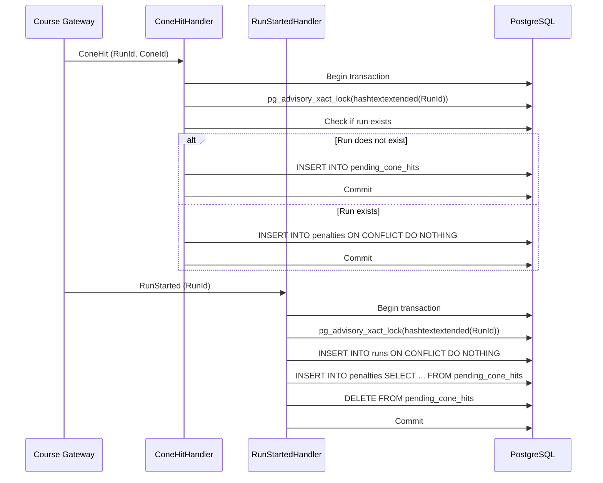

# Notes

## Decisions

**`ConeHit` before `RunStarted` - what League does, and why:**

If a `ConeHit` arrives before its `RunStarted`, League stores it in a `pending_cone_hits` table. When `RunStarted` is later handled, it creates the run and atomically moves all pending cone hits for that `RunId` into `penalties`.

Why: the course gateway delivers events at least once and not in order. Dropping an early `ConeHit` would lose a real penalty, and inserting it directly into `penalties` would violate the foreign key because the run does not yet exist. A pending buffer preserves both referential integrity and the penalty data.

To keep `RunStarted` and `ConeHit` safe from each other, both handlers now acquire the same per-`RunId` PostgreSQL transactional advisory lock before acting. This serializes any two events for the same run so a `ConeHit` and a `RunStarted` cannot race on the pending/penalty state.

Tests that back this up:

**ConeHitHandlerTests**
- Deduplicates repeated ConeHits, including V1 retransmissions with different event IDs.
- Reconciles pending hits when a run starts, including multiple and duplicate hits.
- Handles distinct cones and concurrent ConeHit/RunStarted events correctly.
- Returns penalties ordered by sensor timestamp and an empty list when none exist.

**EventOrderingTests**
- Verifies both lock acquisition orders: ConeHit first and RunStarted first.
- Uses per-run advisory lock inspection and polling for deterministic synchronization.

**RunStartedHandlerTests**
- Ensures duplicate RunStarted events create one run and reconcile pending hits only once.

**LeaderboardTests**
- Verifies ranking by total time, penalty count, and finish timestamp; excludes unfinished runs.

**Other trade-offs you made:**

- Idempotency: Chose database-level `ON CONFLICT DO NOTHING` over application-level duplicate checks, avoiding extra queries and EF tracking.
- Registration concurrency: Chose a database transaction and atomic update over application-level locking, keeping concurrency control at the database level.
- Leaderboard ranking: Chose in-memory sorting over SQL-based ranking, favoring simpler, more testable logic for the expected small number of runs per heat.
- Redis consumer reliability: `CourseEventsConsumer` now dispatches each event before acknowledging it, so a failed handler leaves the message pending instead of losing it. Pending entries idle for more than 30 seconds are recovered with `XAUTOCLAIM` and processed through the same dispatch path — including messages abandoned by a consumer that stopped running. Redelivery is safe because all handlers are idempotent (`ON CONFLICT DO NOTHING`), and shutdown cancellation propagates instead of being logged as a failure. Known limitation: a poison message that always fails is retried indefinitely; a retry limit with a dead-letter stream would be the production follow-up.
- Run/penalty concurrency: Chose PostgreSQL transactional advisory locks over Redis locks because the database is the source of truth and the advisory lock is released automatically at transaction end. A Redis lock would be held in a separate store, would need a TTL long enough to cover the database transaction, and would introduce the risk of the lock expiring before the commit.

## AI usage

**Tools, and what you used them for:**

- Devin shell and file tools for the .NET and Angular edits and test runs.
- ChatGPT for double checking the design and code.

Worked in step by step mode: split the work into small tasks and verified manually each step before moving on.

**One AI suggestion you rejected or changed, and why:**

My first driver-search fix used only `switchMap` to cancel stale requests, but it fired a request on every keystroke and lacked `distinctUntilChanged()`. My first debounce version applied `debounceTime(300)` before `switchMap`, which left the previous request alive during the 300 ms window. The final version puts `timer(300)` inside the outer `switchMap`, so a new search term immediately cancels the previous timer or in-flight HTTP request, and the new request fires only after 300 ms without further input.

I did not touch Angular recently, but I knew how request cancellation and debounce should work; I implemented it the Angular way (unsubscribing the previous `HttpClient` observable aborts the request) and would consider diving deeper into the traditional `AbortController` approach.

## Shortcuts and next steps

**What you skipped, and what you'd do next with more time:**

- I briefly fixed the UI — it is far from perfect, both functionally and visually. For example, the Drivers page loads results without any loading indication, so the user gets no feedback while a search is in flight; a spinner or skeleton state would be a good first fix. Also no feel of how many drivers are in the system. The search is not intuitive.
- No full end-to-end test across the Redis stream, Telemetry, and League services. I would add a test that publishes a simulated stream and reads the leaderboard.
- The `pending_cone_hits` table has no cleanup for hits whose `RunStarted` never arrives; a retention column or periodic sweep would be useful.
- `RunFinished` before `RunStarted` is currently ignored; a pending finish buffer or post-`RunStarted` reconciliation would preserve out-of-order finishes.
- CI/CD pipeline (not set up): add GitHub Actions to run `dotnet test` and `npm test` on pull requests, build Docker images, apply EF migrations, and deploy to staging/production.
- Code review was self-review by the same developer, not an independent reviewer.
- API docs: add OpenAPI/Swagger for the League API.
- Observability: add health checks, metrics, and structured logging.
- Real-time leaderboard: replace polling with SignalR/WebSocket updates.
- Database indexes: add `runs.heat_id`, `penalties.run_id`, and `registrations.heat_id` if query volume grows.
- More Angular tests: component tests for leaderboard, registration, and search. Also reviewing the existing tests and the codebase itself.
- Security: add auth, rate limiting, and input validation.
- Lint/format: add `dotnet format`, `eslint`, and `prettier` to CI.
- Dependency updates: add Dependabot/Renovate.
- Documentation: invest in API docs, user guides, and architecture docs.
- Protect `main` from direct commits: add branch protection rules or require PR reviews.
