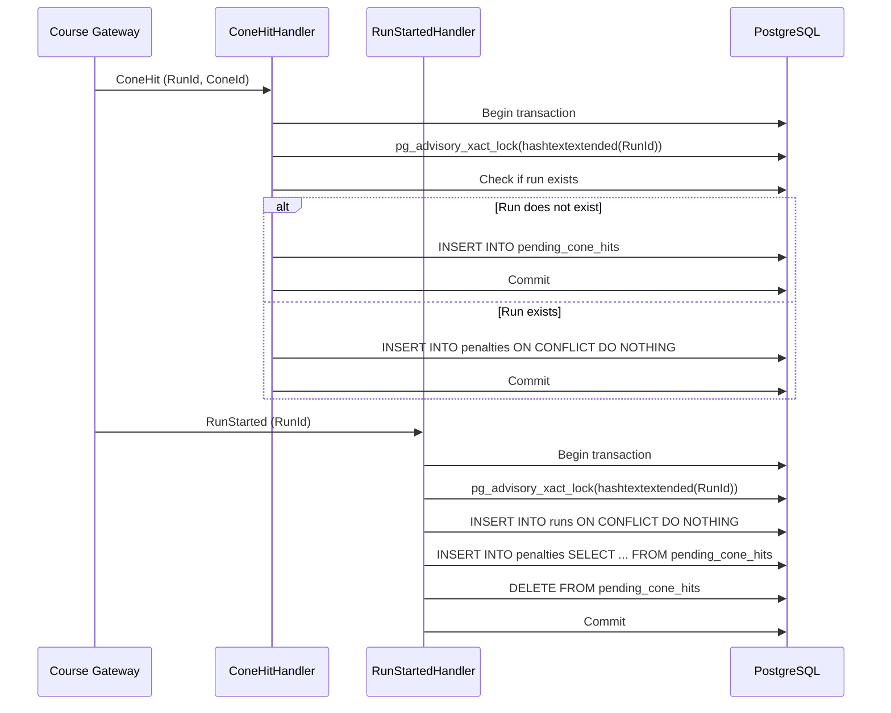

# Notes

## Decisions

**`ConeHit` before `RunStarted` - what League does, and why:**

If a `ConeHit` arrives before its `RunStarted`, League stores it in a `pending_cone_hits` table. When `RunStarted` is later handled, it creates the run and atomically moves all pending cone hits for that `RunId` into `penalties`.

Why: the course gateway delivers events at least once and not in order. Dropping an early `ConeHit` would lose a real penalty, and inserting it directly into `penalties` would violate the foreign key because the run does not yet exist. A pending buffer preserves both referential integrity and the penalty data.

To keep `RunStarted` and `ConeHit` safe from each other, both handlers now acquire the same per-`RunId` PostgreSQL transactional advisory lock before acting. This serializes any two events for the same run so a `ConeHit` and a `RunStarted` cannot race on the pending/penalty state.

Tests that back this up (`ConeHitHandlerTests`):

- `Handling_the_same_ConeHit_twice_adds_one_penalty` — idempotent `ConeHit` for an existing run.
- `V1_retransmissions_with_different_event_ids_are_deduped` — v1 `ConeHit` retransmissions with different `EventId`s still produce one penalty.
- `Pending_cone_hits_are_reconciled_when_run_starts` — `ConeHit` before `RunStarted` is moved to `penalties` when the run starts.
- `Duplicate_v1_ConeHits_before_RunStarted_create_only_one_penalty` — duplicate v1 `ConeHit`s before `RunStarted` are deduplicated in `pending_cone_hits`.
- `Concurrent_ConeHit_and_RunStarted_store_the_penalty` — `ConeHit` and `RunStarted` fired in parallel do not race.
- `Concurrent_ConeHit_and_RunStarted_store_the_penalty_both_orders` — covers both start orders, but uses a 200 ms delay heuristic; a fully deterministic test would need a synchronization hook inside the handlers.

**Other trade-offs you made:**

- Used raw `INSERT ... ON CONFLICT DO NOTHING` for cone-hit and penalty inserts to keep the handlers idempotent without loading entities into EF change tracking.
- Kept leaderboard ranking in memory: per-heat finished runs are few, and the sort order (total time, then penalty count, then finish sensor timestamp) is easier to verify in C# than in SQL.
- `RegistrationService` uses an atomic `ExecuteUpdateAsync` to reserve a spot before inserting the registration, and a unique constraint on `(HeatId, DriverId)` guards against duplicate registration races.

## AI usage

**Tools, and what you used them for:**

- Devin shell and file tools for the .NET and Angular edits and test runs.
- ChatGPT for double checking the design and code.

Worked in step by step mode: split the work into small tasks and verified manually each step before moving on.

**One AI suggestion you rejected or changed, and why:**

My first driver-search fix used only `switchMap` to cancel stale requests, but it fired a request on every keystroke and lacked `distinctUntilChanged()`. 
The debounce alone did not cancel in-flight requests, so the `AbortController`/`xhr.abort()` technique via `switchMap` was kept to abort the previous request. I improved it by adding `debounceTime(300)` and `distinctUntilChanged()`, so the search waits for a typing pause and skips duplicate queries.

I did not touch Angular recently, but I knew how `AbortController` and debounce should work; I implemented it the Angular way and would consider diving deeper to check the traditional approach.

## Shortcuts and next steps

**What you skipped, and what you'd do next with more time:**

- I briefly fixed the UI — it is far from perfect, both functionally and visually.
- No full end-to-end test across the Redis stream, Telemetry, and League services. I would add a test that publishes a simulated stream and reads the leaderboard.
- The `pending_cone_hits` table has no cleanup for hits whose `RunStarted` never arrives; a retention column or periodic sweep would be useful.
- `RunFinished` before `RunStarted` is currently ignored; a pending finish buffer or post-`RunStarted` reconciliation would preserve out-of-order finishes.
- CI/CD pipeline (not set up): add GitHub Actions to run `dotnet test` and `npm test` on pull requests, build Docker images, apply EF migrations, and deploy to staging/production.
- Code review was self-review by the same developer, not an independent reviewer.
- API docs: add OpenAPI/Swagger for the League API.
- Observability: add health checks, metrics, and structured logging.
- Real-time leaderboard: replace polling with SignalR/WebSocket updates.
- Database indexes: add `runs.heat_id`, `penalties.run_id`, and `registrations.heat_id` if query volume grows.
- More Angular tests: component tests for leaderboard, registration, and search.
- Security: add auth, rate limiting, and input validation.
- Lint/format: add `dotnet format`, `eslint`, and `prettier` to CI.
- Dependency updates: add Dependabot/Renovate.
- Documentation: invest in API docs, user guides, and architecture docs.
