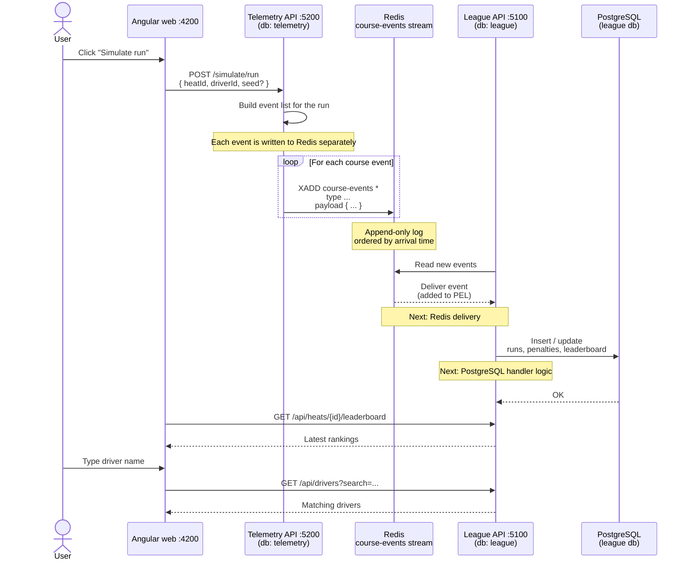

# 01 - PalletRush architecture

**Related docs:** [Index](./00-index.md) · [02 - Event flow](./02-event-flow.md) · [03 - Cone hit lifecycle](./03-cone-hit-lifecycle.md) · [05 - Why Kafka?](./05-kafka-rationale.md) · [06 - Kafka architecture](./06-kafka-architecture.md) · [08 - Proposed UI](./08-ui-management.md) · [09 - Actual screens](./09-actual-screens.md) · [10 - Wireframes](./10-wireframes.md)

This document describes the system from the user's point of view: what a user does in the Angular web UI and how the services react.

## End-to-end flow

## How a run is initiated

1. The user opens the Angular web app at `http://localhost:4200`.
2. They choose a heat and driver and click **Simulate run**.
3. The Angular app sends `POST /simulate/run` with `{ heatId, driverId, seed? }` to the **Telemetry API**.
4. Telemetry's `RunSimulator` generates a realistic run:
   - `RunStarted`
   - `ConeHit` events for 0–4 cones, sometimes duplicated to simulate retransmissions
   - `RunFinished`
   - The first cone may be sent before `RunStarted` to test out-of-order handling
5. Telemetry persists the generated events in its own `telemetry` database and writes them to the Redis `course-events` stream one by one (`XADD` per event).
6. The **League API** reads the stream and invokes the matching handlers.
7. The leaderboard page polls `GET /api/heats/{id}/leaderboard` and shows the ranked results.

## Other user flows

- **Manual event injection (`POST /dev/events`)**: a developer can send a raw `CourseEventEnvelope { type, payload }` directly to Telemetry.
- **Driver search**: the user types in the Drivers page. Angular waits 300 ms after the user stops typing (with `timer(300)` inside `switchMap`) and cancels any in-flight request immediately if the user keeps typing.
- **Heat registration**: the user registers a driver for a heat. The League API uses a database transaction and a unique `(HeatId, DriverId)` constraint to prevent two concurrent registrations from overbooking the last slot.
- **Leaderboard**: the user views a heat's leaderboard, which is refreshed automatically and sorted by total time, then penalty count, then finish timestamp.

## What are failed or abandoned events?

A failed or abandoned event is an event that the League API received from Redis but did not acknowledge with `XACK`.

This can happen when:

- The handler throws an exception.
- The `CourseEventsConsumer` process is killed or restarts before acknowledging.
- `XACK` itself fails.

Redis keeps those events in the consumer group’s **Pending Entries List (PEL)**. The consumer periodically calls `XAUTOCLAIM` to find pending events that have been idle for more than 30 seconds and reprocess them. The retry flow is shown in [02 - What happens when an event reaches Redis](./02-event-flow.md).

## Next

- For how Redis delivers and retries events, see [02 - What happens when an event reaches Redis](./02-event-flow.md).
- For the PostgreSQL handler logic, see [03 - Cone hit and run lifecycle](./03-cone-hit-lifecycle.md).
