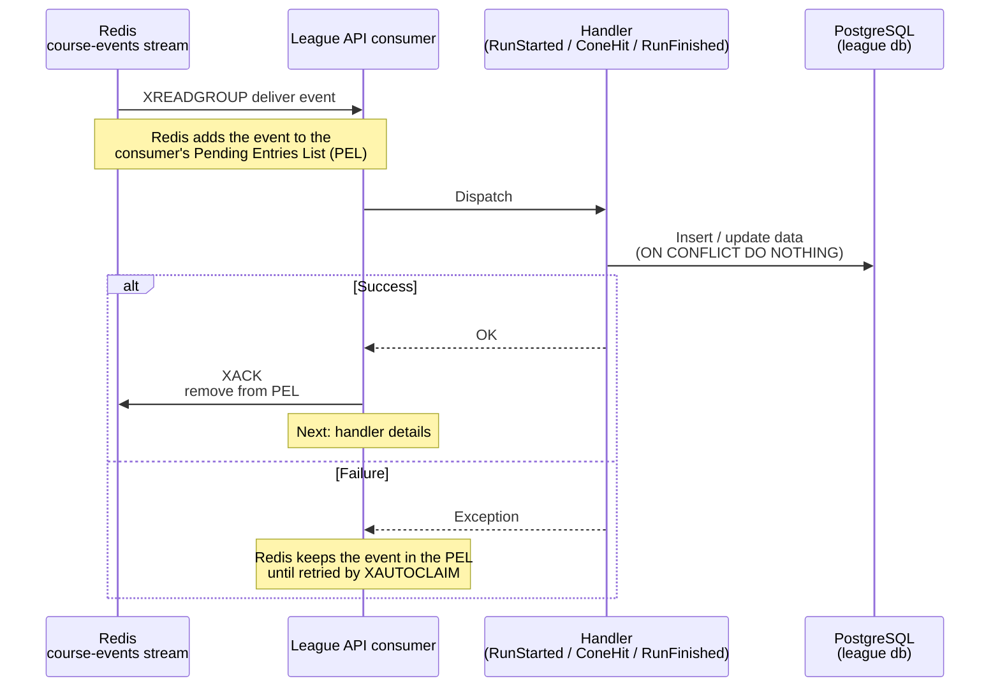
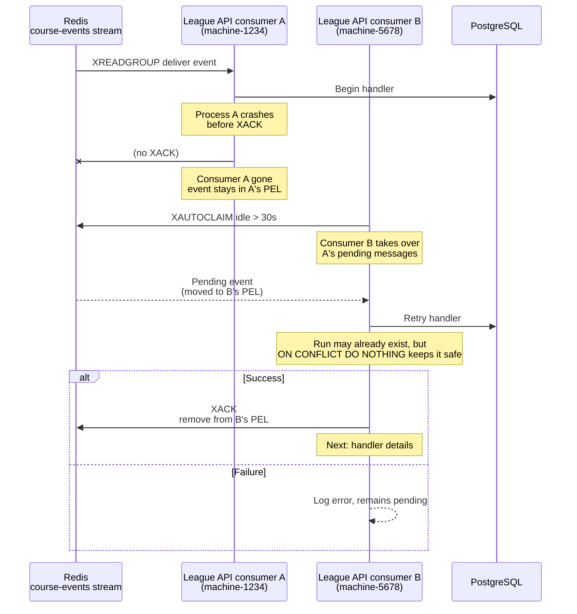

# 02 - What happens when an event reaches Redis

**Related docs:** [Index](./00-index.md) · [01 - Architecture](./01-architecture.md) · [03 - Cone hit lifecycle](./03-cone-hit-lifecycle.md) · [05 - Why Kafka?](./05-kafka-rationale.md) · [06 - Kafka architecture](./06-kafka-architecture.md)

## Short version

1. Redis appends the event to the `course-events` stream.
2. The **League API consumer** (`CourseEventsConsumer`) reads it.
3. It calls the correct handler:
   - `RunStarted`
   - `ConeHit`
   - `RunFinished`
4. If the handler succeeds, the consumer `XACK`s the event — Redis forgets it.
5. If it fails, the event stays pending. The consumer polls with `XAUTOCLAIM`; any pending message idle for more than 30 seconds is reclaimed and retried.

## Full flow

## Who calls XACK and XAUTOCLAIM?

The same **League API `CourseEventsConsumer`**. It uses the `league` consumer group and a consumer name like `MACHINENAME-PID`.

On every loop it does two things:

1. `XAUTOCLAIM` to transfer any pending messages idle for more than 30 seconds to **itself**.
2. `XREADGROUP` to read brand-new messages for **itself**.

If a previous League API process died, the new process's consumer picks up those pending messages with `XAUTOCLAIM`.

## Redis commands used

### `XACK`

`XACK <stream> <group> <id>` removes a message from the consumer group's **Pending Entries List (PEL)**.

The PEL is a Redis data structure that tracks which messages have been delivered to which consumers in a consumer group. PostgreSQL is not involved.

- A message delivered with `XREADGROUP` is placed in the PEL for that consumer.
- `XACK` tells Redis: "this consumer has finished processing this message."
- After `XACK`, the message is removed from the PEL. It stays in the stream, but it will not be redelivered to any consumer in that group.

.NET wrapper: `db.StreamAcknowledgeAsync(...)`.

### `XAUTOCLAIM`

`XAUTOCLAIM <stream> <group> <consumer> <min-idle-time> <start> [count]` reassigns pending messages to a different consumer.

- It looks at the PEL and finds messages that have been idle for at least the given time.
- It transfers ownership of those messages to the calling consumer.
- It returns the messages so the new consumer can process them.

.NET wrapper: `db.StreamAutoClaimAsync(...)`.

## Why 30 seconds?

The 30-second value is the `min-idle-time` passed to `XAUTOCLAIM`. It is **not** a timer inside Redis. Redis does not automatically redeliver messages.

What happens:

1. The consumer calls `XAUTOCLAIM` on every loop (for example, every 500 ms).
2. It asks Redis for pending messages that have been idle for at least 30 seconds.
3. If a message has been idle that long, Redis transfers its ownership to the calling consumer and returns it.
4. The consumer then dispatches and tries to handle it.

30 seconds is a pragmatic trade-off: long enough to avoid interrupting a slow-but-alive consumer, short enough to recover from a crash without losing much time.

## Retry after a consumer crash

`XAUTOCLAIM` is typically used by a **new or different consumer process** to take over work from a process that died.

The important detail is that the recovering consumer is usually a **different process** with a different consumer name. It cannot be the same process, because that process is gone. This is why the main flow diagram in `01-architecture.md` shows the `XAUTOCLAIM` on the same `League API` lifeline only for simplicity — in practice it is the current healthy consumer taking over from a dead one.

## What if the event was already processed?

A retried event is always delivered into the **PEL of the new consumer**. So if `RunStarted` was already created by a previous attempt, the redelivered `RunStarted` still enters the PEL of consumer B.

However, the handler is idempotent:

- `RunStartedHandler` uses `INSERT ... ON CONFLICT (id) DO NOTHING`.
- If the run already exists, the insert is a no-op and the handler returns success.
- Consumer B then `XACK`s the event, and it leaves the PEL.

Without idempotency, the retry would either:

- fail with a duplicate-key error and stay in the PEL forever, or
- create a duplicate run.

The `ON CONFLICT DO NOTHING` pattern is what makes redelivery safe.

## Why the consumer does this

- The stream decouples Telemetry from League. Telemetry writes; League reads when ready.
- `XACK` makes processing reliable: an event is only marked as done after it is actually handled.
- `XAUTOCLAIM` protects against lost messages if a consumer crashes or a handler fails.

## Previous / Next

- Previous: [01 - PalletRush architecture](./01-architecture.md)
- Next: [03 - Cone hit and run lifecycle](./03-cone-hit-lifecycle.md)
