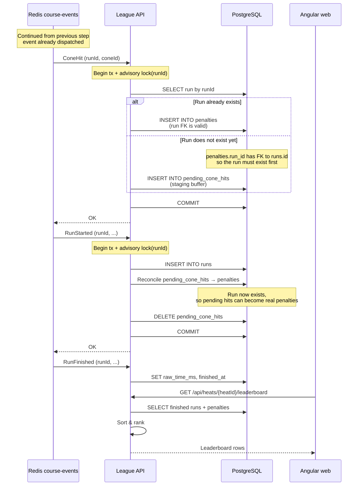

# 03 - Cone hit and run lifecycle

**Related docs:** [Index](./00-index.md) · [01 - Architecture](./01-architecture.md) · [02 - Event flow](./02-event-flow.md) · [05 - Why Kafka?](./05-kafka-rationale.md) · [06 - Kafka architecture](./06-kafka-architecture.md)

What happens from the moment a `ConeHit` or `RunStarted` event is consumed to the moment the leaderboard reflects the penalty.

## Short version

1. A `ConeHit` arrives for a `RunId`.
2. `ConeHitHandler` begins a PostgreSQL transaction and acquires the **advisory lock for that `RunId`**.
3. It checks whether the run already exists:
   - **Yes** → inserts a penalty for the cone into `penalties`.
   - **No** → buffers the hit in `pending_cone_hits`.
4. It commits.
5. A `RunStarted` arrives for the same `RunId`.
6. `RunStartedHandler` begins a transaction and acquires the **same advisory lock**.
7. It creates the run, moves all pending cone hits for that `RunId` into `penalties`, and deletes them from `pending_cone_hits`.
8. It commits.
9. `RunFinished` sets `RawTimeMs` and `FinishedAt`; the leaderboard now includes the run with its total time.

## Full flow



## What is reconciliation?

Reconciliation is the moment `RunStarted` turns buffered `pending_cone_hits` into real `penalties`.

If a `ConeHit` arrives before `RunStarted`, the cone hit is stored in `pending_cone_hits` because the run it belongs to does not exist yet. When `RunStarted` arrives, the `RunStartedHandler` runs:

```sql
INSERT INTO penalties
SELECT run_id, cone_id, 5, sensor_ts
FROM pending_cone_hits
WHERE run_id = @runId
ON CONFLICT (run_id, cone_id) DO NOTHING;

DELETE FROM pending_cone_hits WHERE run_id = @runId;
```

In short: the pending hits are "reconciled" against the run that finally appeared — they are promoted from the pending buffer into actual penalties.

## Why not write the cone hit directly to `penalties`?

1. **Foreign key constraint** — `penalties.run_id` references `runs.id`. The run does not exist yet, so the insert would fail.
2. **Incomplete leaderboard data** — a penalty without a run has no `RawTimeMs` or `FinishedAt`, so it cannot be ranked or displayed.
3. **Out-of-order safety** — `RunStarted` can arrive after `ConeHit`. The pending buffer lets the system accept cone hits in any order and reconcile them when the run finally appears.

## Why the advisory lock?

`ConeHit` and `RunStarted` can arrive in any order and may be handled concurrently. Without coordination:

- `ConeHit` could see "no run" and insert into `pending_cone_hits` while `RunStarted` is still creating the run.
- `RunStarted` could move an empty `pending_cone_hits` set into `penalties` and then `ConeHit` inserts a pending hit that is never reconciled.

By acquiring `pg_advisory_xact_lock(hashtextextended(runId::text, 0::bigint))` at the start of each transaction, the two handlers **serialize per `RunId`**. Whichever starts first owns the lock; the other waits until the first commits. This guarantees a consistent view of the `RunId`.

## Why do both handlers need the same lock?

Because both `ConeHit` and `RunStarted` read and write state tied to the same `RunId`.

Without the shared lock, this race is possible:

1. `ConeHit` checks `runs` — the run does not exist yet.
2. `RunStarted` creates the run and reads `pending_cone_hits` — sees nothing.
3. `RunStarted` deletes (empty) `pending_cone_hits` and commits.
4. `ConeHit` now inserts into `pending_cone_hits`.
5. The cone hit is **orphaned**: it will never be reconciled because `RunStarted` already ran.

With the lock:

- If `ConeHit` acquires it first, it inserts into `pending_cone_hits` and commits. Then `RunStarted` sees the pending hit and moves it into `penalties`.
- If `RunStarted` acquires it first, it creates the run and reconciles an empty `pending_cone_hits`. Then `ConeHit` sees the run exists and inserts directly into `penalties`.

In both orderings, the result is consistent and exactly one penalty is stored.

## Could we avoid the lock and reconcile later?

Yes, but it would make the system **eventually consistent**.

The alternative would be:

1. `ConeHit` always inserts into `pending_cone_hits`.
2. `RunStarted` creates the run but does not move pending hits immediately.
3. A separate reconciliation process periodically scans `pending_cone_hits` and promotes rows whose `run_id` now exists into `penalties`.

This has drawbacks:

- **Temporary inconsistency** — the leaderboard can show the wrong penalty count between the `RunStarted` and the next reconciliation.
- **Extra moving parts** — you need a scheduler, background job, or trigger to run reconciliation.
- **Late hits after `RunFinished`** — a `ConeHit` could arrive after a run is already finalized. You would have to retroactively update the leaderboard or recompute it.
- **Harder testing** — you cannot immediately assert the final state after `RunStarted` because reconciliation may not have run yet.

The advisory lock keeps the same logic immediate and deterministic, so it was chosen for this implementation.

## Idempotency

- `penalties` has a unique constraint on `(run_id, cone_id)`. `ON CONFLICT DO NOTHING` prevents duplicate penalties if the same `ConeHit` is redelivered.
- `pending_cone_hits` has the same unique constraint, so duplicate early hits are also ignored.
- `runs` uses `ON CONFLICT (id) DO NOTHING`, so duplicate `RunStarted` events create only one run.

## Previous

- Previous: [02 - What happens when an event reaches Redis](./02-event-flow.md)
