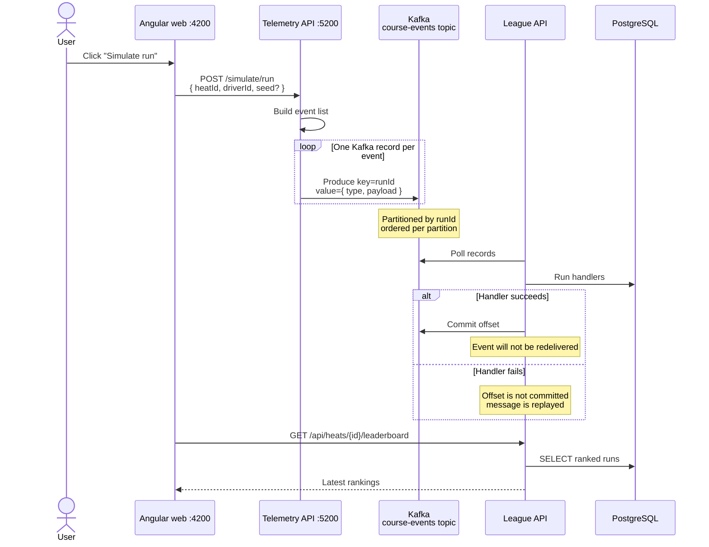

# 06 - Kafka architecture

**Related docs:** [Index](./00-index.md) · [01 - Architecture](./01-architecture.md) · [02 - Event flow](./02-event-flow.md) · [03 - Cone hit lifecycle](./03-cone-hit-lifecycle.md) · [05 - Why Kafka?](./05-kafka-rationale.md) · [07 - Kafka concepts](./07-kafka-concepts.md)

This document describes the PalletRush event flow with Apache Kafka as the message broker.

## Proposed architecture with Kafka



## Key design choices

### 1. Topics

For the current PalletRush event flow, the main topic would be:

- **`course-events`** — contains all `RunStarted`, `ConeHit`, and `RunFinished` events from the Telemetry API / course gateway.

All consumer groups read from this topic:

- `league` group — League API, persists runs, penalties, and leaderboard.
- `analytics` group (optional) — builds reports and statistics.
- `audit` group (optional) — stores every event for compliance.

If the system grows, you could split further:

- `driver-registrations` — when registration becomes an event-driven process.
- `leaderboard-updates` — if the leaderboard service is separated and needs its own feed.

For the Kafka proposal described here, `course-events` is the only topic needed.

### 2. Partitions

Instead of a single Redis stream `course-events`, we would use a Kafka topic called `course-events`.

- **Partition by `runId`** (hashed): guarantees all events for the same run end up in the same partition, preserving per-run ordering.
- **Partition by `heatId`**: useful if you want to parallelize by heat and still keep a heat's events ordered.

A single partition gives global ordering but limits parallelism. Partitioning by `runId` is the safest balance for this domain.

### 3. Producers

The Telemetry API would produce one Kafka record per event:

```text
Topic: course-events
Key:   runId (for partition affinity)
Value: { "type": "ConeHit", "payload": { ... } }
```

Using `runId` as the key ensures all events for a single run — a single driver's attempt within a heat — are processed in order by the same consumer instance. This preserves per-run ordering and makes the PostgreSQL advisory-lock concurrency control more effective, while still allowing different runs (and different drivers in the same heat) to be processed in parallel across partitions.

### 4. Consumers and consumer groups

The League API would run a Kafka consumer in a group called `league`:

- Kafka assigns partitions to consumers in the group automatically.
- Each consumer polls records, dispatches to handlers, and **commits offsets only after success**.
- If a consumer crashes, another consumer in the group takes over its partitions and starts from the last committed offset.
- If a handler fails, we do **not** commit the offset, so the record is replayed.

Unlike Redis, there is no 30-second idle threshold to tune — Kafka rebalances automatically.

### 5. At-least-once with idempotent handlers

Kafka offers stronger semantics:

- **At-least-once** (easiest): produce and commit offsets after success. Idempotent handlers handle duplicates, exactly as we already do with `ON CONFLICT DO NOTHING`.
- **Exactly-once** (more complex): use Kafka transactions to produce and commit offsets together, or store the offset in PostgreSQL alongside the business transaction.

Because the current handlers are idempotent, **at-least-once with idempotent consumers** is the pragmatic and robust choice.

### 6. Multiple consumer groups

With Redis Streams, only one consumer group reads the stream. With Kafka, you can add more consumer groups without affecting the `league` group:

- `league` group — updates runs and penalties.
- `analytics` group — builds heat statistics, writes to a data warehouse.
- `audit` group — stores every event permanently for compliance.

Each group tracks its own offsets and processes at its own speed.

## What stays the same

- The **handler logic** (`ConeHitHandler`, `RunStartedHandler`, `RunFinishedHandler`) does not change.
- **Advisory locks** in PostgreSQL are still needed because `ConeHit` and `RunStarted` for the same `RunId` can be on the same partition but still interleaved during retries.
- **Dispatch-before-ack / commit** remains the core reliability pattern.
- **Idempotency** via `ON CONFLICT DO NOTHING` remains the defense against redelivery.
