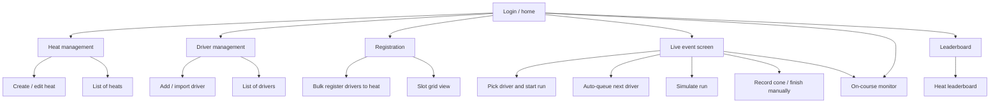
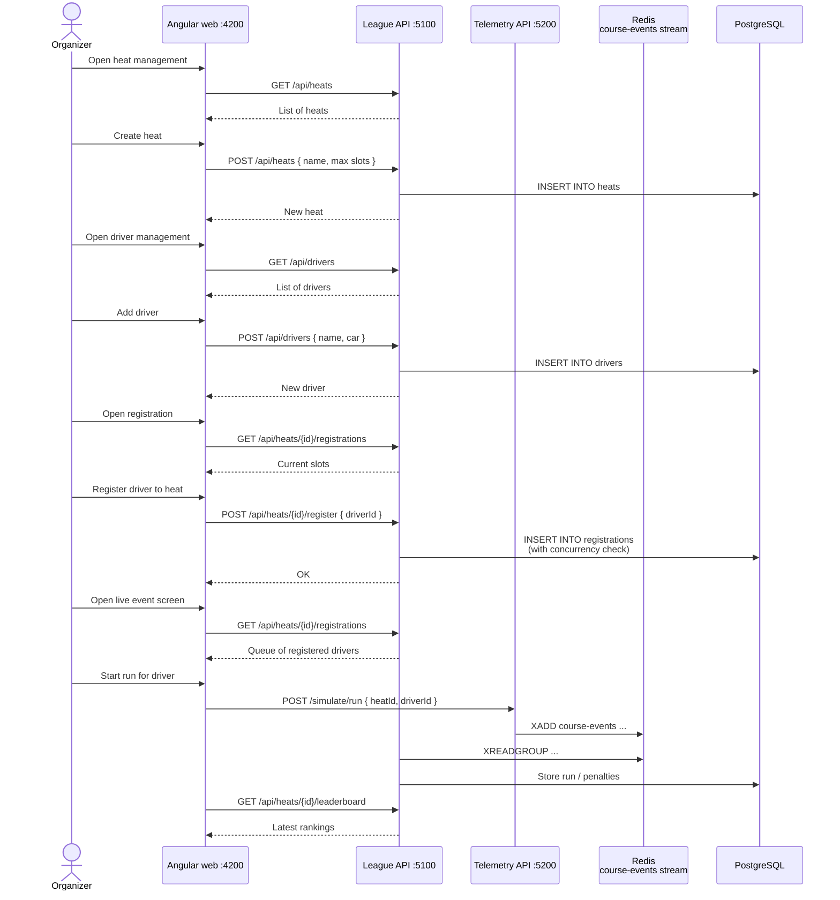

# 08 - Proposed management UI

**Related docs:** [Index](./00-index.md) · [01 - Architecture](./01-architecture.md) · [02 - Event flow](./02-event-flow.md) · [03 - Cone hit lifecycle](./03-cone-hit-lifecycle.md) · [09 - Actual screens](./09-actual-screens.md) · [10 - Wireframes](./10-wireframes.md)

This document describes a better management UI for PalletRush, so organizers can create heats, register drivers, and run events without clicking “Simulate run” one by one.

## Current problem

Today the only way to start a run is the **Simulate run** button in the Angular web app. It is fine for testing, but it does not scale for a real event:

- You must remember `heatId` and `driverId` by heart.
- You can only simulate one run at a time.
- There is no heat setup screen.
- There is no driver management screen.
- There is no bulk registration.
- There is no “next driver, go” flow for a live event.

## Proposed screens

## Proposed flow

## Key improvements

1. **Heat management** — a dedicated screen to create, edit, and list heats.
2. **Driver management** — add or import drivers before the event.
3. **Bulk registration** — register multiple drivers to a heat in one view, with a slot grid.
4. **Live event screen** — the central screen during the race:
   - Shows the queue of registered drivers.
   - One click to start the next run.
   - Shows on-course status.
   - Manual override for cones or finish if the real gateway is not used.
5. **Leaderboard** — per-heat ranking, auto-refreshing.

## Why not “Simulate run” one by one?

In a real race, an organizer does not want to type IDs and click around. They want:

- A queue that shows who is next.
- A single button to start the run.
- Automatic leaderboard refresh.
- Manual overrides when sensors fail.

The proposed management UI makes the application usable for an actual event, not just for integration testing.
