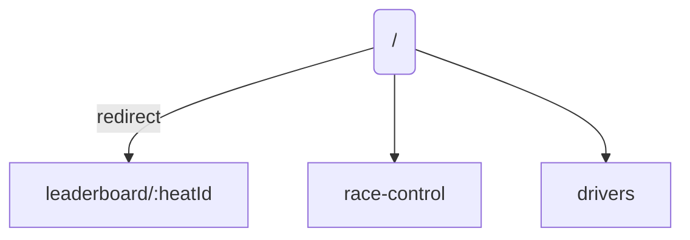
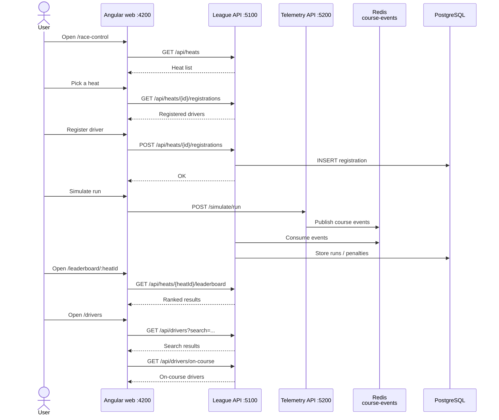

# 09 - Actual screens

**Related docs:** [Index](./00-index.md) · [01 - Architecture](./01-architecture.md) · [02 - Event flow](./02-event-flow.md) · [03 - Cone hit lifecycle](./03-cone-hit-lifecycle.md) · [08 - Proposed UI](./08-ui-management.md) · [10 - Wireframes](./10-wireframes.md)

This document lists the screens that are actually implemented in the Angular web app today.

## Routes

The `app.routes.ts` file defines three main screens:



| Route | Component | Purpose |
|---|---|---|
| `/` | redirect | Redirects to `leaderboard/1` by default. |
| `/race-control` | `RaceControlComponent` | Pick a heat, register a driver, simulate a run. |
| `/drivers` | `DriversComponent` | Search drivers and see who is on course. |
| `/leaderboard/:heatId` | `LeaderboardComponent` | Show the ranked results for a heat. |

## 1. Race control (`/race-control`)

This is the closest thing to a management screen. It lets an organizer pick a heat, register drivers, and simulate runs.

### What it shows

- A table of all heats (`HeatTableComponent`) with name, start time, and `registeredCount / capacity`.
- When a heat is picked: a registration table (`RegistrationTableComponent`) and a registration form (`RegisterFormComponent`).
- A link to the heat's leaderboard.

### What you can do

- **Pick a heat** — sets the active heat in the UI.
- **Register a driver** — choose a driver from a team dropdown and call:
  ```
  POST /api/heats/{heatId}/registrations
  { driverId }
  ```
- **Simulate a run** — for each registered driver, click **Simulate run**, which calls:
  ```
  POST /simulate/run
  { heatId, driverId }
  ```
  The Telemetry API then generates `RunStarted`, `ConeHit`s, and `RunFinished` and publishes them to Redis.

### Current limitations

- No create/edit heat screen.
- No create/edit driver screen.
- No bulk registration.
- You must click **Simulate run** per driver, one by one.

## 2. Drivers (`/drivers`)

A two-section screen.

### Driver search (`app-driver-search`)

- A search input. When the user stops typing for 300 ms, it calls:
  ```
  GET /api/drivers?search={query}
  ```
- The results list shows driver name, team, and license number.
- Uses `timer(300)` inside `switchMap` so a new keystroke immediately cancels the previous request.

### On-course monitor (`app-on-course`)

- Polls every 2 seconds:
  ```
  GET /api/drivers/on-course
  ```
- Shows the list of drivers currently on the course.

### Current limitations

- No loading indicator while search results load.
- No total driver count.
- Polling continues while the page is open; it stops only when the component is destroyed (user navigates away).

## 3. Leaderboard (`/leaderboard/:heatId`)

- Polls every 3 seconds:
  ```
  GET /api/heats/{heatId}/leaderboard
  ```
- Shows ranked rows with rank, driver, team, raw time, penalty count, penalty time, and total time.
- Clicking a row loads the run's penalties:
  ```
  GET /api/runs/{runId}/penalties
  ```
- Penalties are displayed in a list below the table with cone ID, seconds, and sensor timestamp.

## How the screens map to the backend



## See also

For a more complete management UI design, see [08 - Proposed management UI](./08-ui-management.md).
