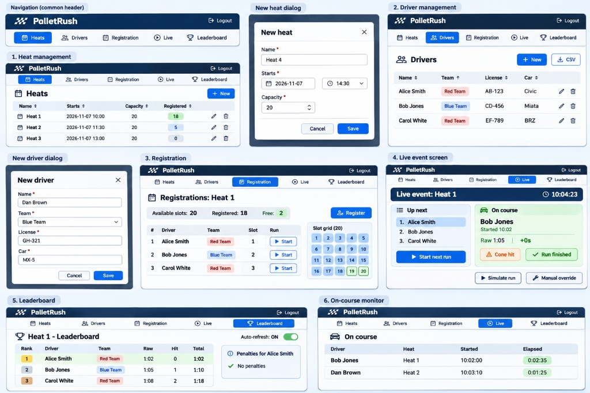

# 10 - Wireframes

**Related docs:** [Index](./00-index.md) · [08 - Proposed management UI](./08-ui-management.md) · [09 - Actual screens](./09-actual-screens.md)

The wireframes below show the proposed management UI for PalletRush. They replace the ASCII sketches from the earlier version.

## Screen overview

1. **Heat management** — list of heats with capacity, registered count, start time, and edit/delete actions.
2. **New heat dialog** — create a new heat with name, start date/time, and capacity.
3. **Driver management** — list of drivers with team, license, car, and edit/delete actions.
4. **New driver dialog** — add a driver with name, team, license, and car.
5. **Registration** — view and manage registrations for a selected heat, including a slot grid.
6. **Live event screen** — the main race view: up-next queue, on-course driver, and quick actions (start next run, cone hit, run finished, simulate, manual override).
7. **Leaderboard** — ranked results for a heat with raw time, hits, penalty time, and total time.
8. **On-course monitor** — list of drivers currently on the course with elapsed time.
